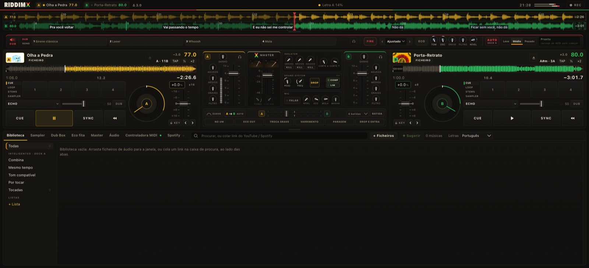

<p align="center">
  
</p>

<h1 align="center">RiddimX</h1>

<p align="center">
  App de DJ para reggae, dub e sound system, para macOS.<br>
  Dois decks, mixer de mesa de dub, efeitos de fita e mola, sirenes, sampler,<br>
  e separação de stems e letras feitas por IA no próprio Mac.
</p>

<p align="center">
  <a href="../../releases/latest"><b>⬇️ Baixar a última versão</b></a>
  &nbsp;·&nbsp; macOS 13 Ventura ou mais novo &nbsp;·&nbsp; Apple Silicon e Intel
</p>



---

## Índice

- [Instalar](#instalar)
- [Primeiros passos](#primeiros-passos)
- [O que a RiddimX faz](#o-que-a-riddimx-faz)
- [Controladoras MIDI](#controladoras-midi)
- [Problemas comuns](#problemas-comuns)
- [Para desenvolvedores](#para-desenvolvedores)
- [Créditos e licenças](#créditos-e-licenças)

---

## Instalar

### 1. Descubra qual é o seu Mac

Clique em ** → Sobre Este Mac** e veja a linha **Chip** ou **Processador**:

| Aparece | Baixe este arquivo |
| --- | --- |
| **Chip Apple** M1, M2, M3 ou M4 | `RiddimX-mac-apple-silicon.zip` |
| **Processador Intel** | `RiddimX-mac-intel.zip` |

Os dois arquivos ficam na página de [**Releases**](../../releases/latest), em **Assets**. Precisa ser macOS 13 (Ventura) ou mais novo. Sequoia (15) funciona.

### 2. Descompacte e mova para Aplicativos

Dê dois cliques no ZIP. Aparecem a **RiddimX** e o arquivo **COMO ABRIR.txt**. Arraste a **RiddimX** para a pasta **Aplicativos**.

### 3. Libere a app (uma vez só)

A RiddimX ainda não é registrada na Apple, então o macOS bloqueia a primeira abertura e às vezes diz que ela está **"danificada"**. Ela não está danificada: é só a marca de "baixado da internet".

Abra o **Terminal** (aperte `⌘ Espaço`, digite `Terminal`, aperte Enter), cole este comando e aperte Enter:

```bash
xattr -dr com.apple.quarantine /Applications/RiddimX.app
```

Não aparece nada depois, e isso é normal.

### 4. Abra

Abra a RiddimX pela pasta **Aplicativos**. Se ainda aparecer **"não foi possível verificar"**:

1. Clique em **OK** (não em "Mover para o Lixo").
2. Vá em **Ajustes do Sistema → Privacidade e Segurança**, role até o fim e clique em **Abrir Mesmo Assim**.
3. Abra a RiddimX de novo e confirme **Abrir**.

Pronto: daqui em diante ela abre normalmente.

---

## Primeiros passos

1. **Adicione músicas:** arraste arquivos de áudio (MP3, WAV, FLAC, M4A, AIFF…) para a janela, ou clique em **+ Ficheiros** na Biblioteca. Também dá para colar um link do YouTube na caixa de procura.
2. **Carregue num deck:** dois cliques numa música carregam no deck livre. As setas `←` e `→` mandam para o deck A ou B.
3. **Stems:** na primeira vez que uma música é carregada, a RiddimX separa sozinha **voz, baixo, bateria e instrumentos** (1 a 2 minutos; depois fica guardado). Os pads **STEMS** de cada deck ligam e desligam cada parte.
4. **Letras:** as letras que existem na internet aparecem sozinhas sobre as ondas, no tempo certo. Para a app escrever também a letra das outras músicas, vá em **Biblioteca → Instalar letras · 547 MB** (uma vez só, precisa de internet).
5. **Mixe:** o crossfader fica na parte de baixo do mixer. As transições automáticas (**ECO OUT**, **TROCA GRAVE**, **VARRIMENTO**…) trocam de música na batida.

O Mac pede acesso ao microfone quando você usa o **Mic** ou grava a sua voz para os drops. Pode permitir.

---

## O que a RiddimX faz

### Decks
- Ondas das duas faixas lado a lado, com **marcas de compasso numeradas**, para alinhar o "1" de uma com o "1" da outra.
- BPM, tom (com a roda de Camelot), pitch com KEY lock, jog com scratch e nudge.
- Pads de **cue, loop, stems e sampler**.
- Efeitos por deck e o botão **DUB**.

### Mixer de mesa de dub
- Canais com ganho, agudos, médios, graves e filtro.
- **Isolator** do master, com KILL de graves, médios e agudos.
- **Sound system:** PESO (sub-grave), DROP, compressor e limiter.
- **Mic** do MC, com eco, mola e música que baixa enquanto ele fala.
- VU de agulha e fones com mistura cue/master.
- **Transições na batida:** no um, eco out, troca de grave, varrimento, paragem e drop.

### Dub
- **Dub Box:** sirenes, laser e mola, com sons próprios e pads.
- **Dub automático:** a app desmonta e remonta a música ao vivo usando os stems.
- **Eco de fita** com mola, throw por deck e tempo pela batida.

### Biblioteca
- Procura também dentro das letras.
- **Listas inteligentes:** Combina, Mesmo tempo, Tom compatível, Por tocar e Tocadas.
- **✦ Sugerir:** carrega no deck livre a melhor música para tocar em seguida.

### Mais
- **Sampler e drops:** grave a sua voz, use vozes do Mac ou recorte uma frase de uma música.
- **Gravação da mixagem** e integração com o **Spotify** (conta Premium).

---

## Controladoras MIDI

A RiddimX reconhece sozinha:

- **Hercules DJControl Inpulse 200 MK2:** decks, pads, browser e luzes.
- **M-Audio O2:** sirenes e dub, tocando a sirene no teclado.

Para qualquer outra controladora, vá em **Controladora MIDI**, escolha a função e clique em **Aprender**. Depois é só mexer no botão ou knob da controladora.

---

## Problemas comuns

<details>
<summary><b>"A RiddimX está danificada e não pode ser aberta"</b></summary>

Refaça o [passo 3](#3-libere-a-app-uma-vez-só) (o comando no Terminal). A app não está danificada.
</details>

<details>
<summary><b>Não aparece o botão "Abrir Mesmo Assim"</b></summary>

Ele só aparece em **Privacidade e Segurança** depois de você tentar abrir a app pelo menos uma vez. Tente abrir, clique em OK e volte lá.
</details>

<details>
<summary><b>A app não abre de jeito nenhum</b></summary>

Confira se o ZIP é o do seu Mac (Apple ou Intel) e se o macOS é 13 ou mais novo. Se mesmo assim não abrir, mande um print da mensagem e o que aparece em ** → Sobre Este Mac**.
</details>

<details>
<summary><b>Os stems demoram</b></summary>

Só na primeira vez de cada música: de 1 a 2 minutos num Mac com chip Apple, e um pouco mais num Intel. Depois ficam guardados.
</details>

<details>
<summary><b>A letra não aparece</b></summary>

Para músicas que não estão no catálogo online, instale as letras em **Biblioteca → Instalar letras**. Músicas instrumentais não têm letra.
</details>

---

## Para desenvolvedores

Feita com **Electron**, **React**, **TypeScript** e **Vite**. O áudio é todo em Web Audio.

```bash
npm install
npm run desktop          # app em modo de desenvolvimento
npm run package          # gera release/RiddimX-darwin-arm64 (Apple Silicon)
npm run package:intel    # gera release/RiddimX-darwin-x64 (Intel)
```

### Modelo de stems (não vai para o git)

O modelo Demucs em ONNX tem 166 MB, mais do que o limite do GitHub. Para criá-lo:

```bash
python3 -m venv .venv-stems
.venv-stems/bin/pip install demucs onnx onnxruntime
.venv-stems/bin/python tools/export_demucs_onnx.py public/models/htdemucs.onnx
.venv-stems/bin/python tools/check_demucs_onnx.py <música.wav> public/models/htdemucs.onnx   # compara com o Demucs original
```

### Como a IA roda no Mac

| Função | Motor | Onde está |
| --- | --- | --- |
| Stems | Demucs `htdemucs` em ONNX, na GPU (WebGPU) ou na CPU (WebAssembly) | `src/engine/ai/` |
| Letras | `whisper.cpp` 1.9.5 compilado para arm64 e x86_64, com Metal | `electron/bin/` |

O modelo de letras (`ggml-large-v3-turbo-q5_0`, 547 MB) é baixado pela própria app, e ela confere o arquivo pelo SHA-256 antes de usar.

### Estrutura

```
src/
  engine/        áudio: decks, mixer, efeitos, dub box, transições, IA
  components/    interface (React)
electron/        janela, servidor local, stems e letras no lado do Mac
tools/           exportar e conferir o modelo de stems
brand/           logos e ícones
```

---

## Créditos e licenças

- [Demucs](https://github.com/facebookresearch/demucs) (Meta): separação de stems, licença MIT.
- [whisper.cpp](https://github.com/ggml-org/whisper.cpp) (ggml): transcrição de letras, licença MIT. O texto da licença vem com a app (`WHISPER-LICENSE.txt`).
- [ONNX Runtime](https://github.com/microsoft/onnxruntime) (Microsoft): motor de IA, licença MIT.
- Letras online: [LRCLIB](https://lrclib.net).

Os sons de efeito em `public/sfx` são para uso pessoal.
